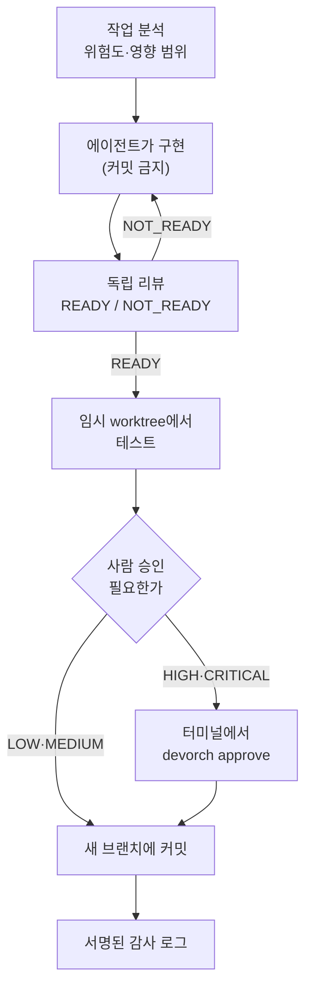

# DevOrch — AI 코딩 에이전트를 위한 통제 엔진

> AI 에이전트가 쓴 코드를 **바로 반영하지 않고**, 위험도를 분석하고 독립 리뷰·테스트·사람 승인을 통과한 변경만 새 브랜치에 커밋합니다.
> Claude Code 같은 에이전트에는 **MCP 서버**로 붙고, 사람은 CLI와 읽기 전용 대시보드로 확인합니다.

## 쉽게 말하면

AI 에이전트(Claude Code 등)가 코드를 고칠 때 **사이에 끼는 검문소**입니다.

- **막는 것:** 리뷰 없이, 테스트가 깨진 채로, 에이전트 혼자 승인한 채로 코드가 반영되는 일. 앞 단계를 통과하지 못하면 다음 단계 도구가 실행을 거부합니다.
- **사람이 하는 일:** 위험한 변경만 터미널에서 직접 승인합니다. 에이전트는 승인을 대신할 수 없습니다.
- **비용:** 위험이 낮은 작업은 리뷰어를 건너뛰어 돈을 아끼고, 위험한 작업에만 독립 리뷰어를 붙입니다. 리뷰어 한 번은 약 1센트입니다(아래 실측).
- **정직한 한계:** AI 리뷰어는 실제 버그를 일부만 찾습니다. 그래서 이 도구는 "버그를 잡아 주는 도구"가 아니라 **"승인 없이는 반영되지 않게 통제하는 도구"** 입니다.



## 30초 시작

Python 3.11 이상과 git이 필요합니다.

```bash
git clone https://github.com/YunhuPark/devorch.git
cd devorch
python -m venv .venv
. .venv/bin/activate          # Windows PowerShell: .\.venv\Scripts\Activate.ps1
pip install -e ".[dev,llm]"          # 약 4~5분(제작자 PC 기준 246초)

devorch quickstart          # 이 하나로: git 확인 → 초기화 → 점검 → 정책 승인 → MCP 등록 명령과 첫 요청 예시
```

`devorch quickstart`가 알려 주는 `claude mcp add devorch ...` 명령으로 Claude Code에 연결한 뒤, 에이전트에게 이렇게 말하면 됩니다.

```
devorch 로 진행해줘: <바꾸고 싶은 작업 한 줄>
```

처음 써 보는 것이라면 `devorch quickstart --mock`으로 **키도 비용도 없이** 흐름만 시험할 수 있습니다. API 키는 환경변수로만 넣습니다. 전체 사용법은 [상세 레퍼런스](docs/REFERENCE.md)에 있습니다.

## 사람이 하는 일 (3가지)

| 언제 | 무엇을 | 명령 |
|---|---|---|
| 처음 한 번, 그리고 정책·설정을 고친 뒤 | 정책 파일을 확인하고 승인. 승인한 상태와 달라지면(에이전트가 몰래 고치면) 에이전트 도구가 멈춥니다 | `devorch policy accept` |
| 에이전트가 "승인 필요"에서 멈췄을 때 | diff·리뷰·테스트 결과를 보고 승인 또는 거부. 에이전트는 이 명령을 실행할 수 없습니다 | 에이전트가 알려 준 `devorch approve <task_id>` 명령을 그대로 붙여넣기 |
| 에이전트가 "커밋됐다"고 알려 준 뒤 | 에이전트가 남긴 미커밋 수정을 정리하고 브랜치를 merge. 정리는 커밋된 내용과 정확히 같은 파일만 되돌립니다 | `devorch finish <task_id>` → `git merge <브랜치>` |

## 내 프로젝트에 적용해 본 결과

내 공개 저장소 `algo-pipeline`(Python, 인스타그램 카드뉴스 자동 발행, 테스트 200개)에 실제 Claude Code로 붙여 써 봤습니다. **표본이 작아서 일반화하지 않습니다.** 근거와 한계는 [사례 연구](docs/CASE_STUDY.md)와 [실사용 기록](docs/DOGFOOD_LOG.md)에 있습니다.

| 무엇을 | 결과 |
|---|---|
| 실제 Claude Code가 규칙대로 끝까지 진행(분석→수정→리뷰→테스트→커밋) | **4/4** 작업, 저장소 테스트 매번 통과(200→203개) |
| 위험도 분류 | low 3 · medium 1. **놓친 것으로 본 사례 1건**(발행 큐 가드 변경이 LOW) → 소유자가 경로를 지정하는 `protected_paths`로 보완. 같은 변경이 HIGH·승인 필요로 바뀜 |
| IDE에서 사람이 직접 승인 → 브랜치 커밋 | 3회 확인(그중 `finish` → merge까지 IDE에서 직접 한 것은 1회) |
| 사용하면서 나온 문제 → 고침 | 4개: 테스트가 가짜 키를 요구하는 저장소(`test_env`), 커밋 뒤 미커밋 수정(`finish`), 위험도 분류 누락(`protected_paths`), 정책 파일 몰래 수정(`policy accept`) — 각각 재현 → 수정 → 테스트 |
| 내 저장소에 보호 경로 적용 | 23개 경로(PR #13 머지). 최근 60개 커밋에 적용하면 **네 변경 중 하나쯤이 사람 승인 대상**(high 이상 28%) |

### 직접 써 보며 겪은 불편과 고친 것

제작자 본인이 쓰면서 겪은 것과, 실제 Claude Code를 돌려 보다가 찾은 것을 **구분해서** 적습니다.

| 겪은 불편 | 누가 겪었나 | 고친 것 |
|---|---|---|
| 승인·커밋이 끝났는데 에이전트가 남긴 미커밋 수정 때문에 `git merge`가 막힘 | **IDE에서 직접 승인하며 사용자가 겪음** | `devorch finish`. 커밋된 내용과 정확히 같은 파일만 되돌림. IDE에서 직접 merge 성공을 확인 |
| 낡은 MCP 서버가 새 안내(`how_to_finish`)를 주지 못함, 이전 대화의 기억 때문에 이미 지운 브랜치를 언급 | **IDE에서 사용자가 겪음** | 시연 절차에 "서버 재연결 + 새 채팅" 단계 추가. 이후 재시연에서 안내가 정상 전달되는 것을 확인 |
| 에이전트가 알려 준 승인 명령을 그대로 붙여넣으면 안 돌아감(이 PC에서 `devorch` 런처가 안 되고, 다른 폴더에서는 프로젝트를 못 찾음) | 실제 Claude Code를 헤드리스로 돌리다 발견 | 파이썬 경로·`-m devorch`·`-p`를 모두 넣어 **그대로 실행되는 명령**을 안내 |
| `git status`가 지저분해짐(새로 생기는 파일을 `.gitignore`가 몰랐음) | 같은 실행 | 필요한 항목을 자동으로 추가 |
| 테스트가 가짜 키라도 요구하는 저장소에서 테스트가 시작도 못 함 | 내 저장소에 적용하다 발견 | `project.test_env` |
| 터미널에서 복사한 한글 출력이 줄바꿈으로 갈라져 보임(승인은 1번만 기록됨) | IDE에서 사용자가 관찰 | **고치지 않음**(표시·복사 문제로 판단) |

### 실제 리뷰어를 붙였을 때 (OpenAI 1개, 호출 15회)

| 항목 | 결과 |
|---|---|
| 비용 | 합계 약 **$0.195**, 호출당 $0.0009~$0.0365(보통 약 1센트). 예상 범위 안 15/15 |
| 비용 추정의 정확도 | 입력 토큰은 대부분 ±10% 안, **출력 토큰은 예상의 0.1~2.3배로 편차가 큼** |
| 같은 diff를 여러 번 보냈을 때 | 비용 $0.0095~$0.0120, 경고 내용이 매번 달랐고 판정이 뒤집힌 경우도 있음(5개 중 1개) |
| **리뷰어가 찾은 실제 결함** | 내 저장소에서 **2개**(재현함 → PR #14·#15로 수정). 다른 지적 3개(차단 2·경고 1)는 틀리거나 부정확했음 |

> 리뷰어의 지적은 **그대로 믿지 않고 코드를 읽어 하나씩 검증**했습니다. 에이전트가 만든 변경 4건에서는 확인된 실제 결함이 없었고, 결함은 사람이 쓴 과거 커밋에서 나왔습니다. **비용 절감이 입증된 것은 아닙니다.** 위험이 낮은 작업의 리뷰어 호출을 건너뛴 것은 "전부 리뷰"를 기준으로 삼은 추정이고, 에이전트 자신의 비용은 DevOrch가 보지 못합니다.

## 왜 만들었나

AI 코딩 에이전트는 빠르지만, 잘못된 변경도 똑같이 빠르게 들어옵니다. 리뷰가 빠지거나, 테스트가 깨진 채 반영되거나, 에이전트가 승인 단계를 건너뛸 수 있습니다.
DevOrch는 "AI가 코드를 잘 쓰게 만드는 도구"가 아니라 "**잘못 동작할 때 멈추게 만드는 도구**"입니다.

## 핵심 설계

| 원칙 | 구현 |
|---|---|
| **단계를 건너뛸 수 없다** | 분석 → 리뷰 → 테스트 → 반영을 MCP 도구로 나누고, 리뷰가 없거나 `NOT_READY`면 테스트·반영 도구가 거부 |
| **검토한 것만 반영된다** | 리뷰·테스트·승인이 모두 **diff의 SHA**에 묶임. 이후 한 줄이라도 바뀌면 이전 결과는 무효 |
| **실패는 통과가 아니다 (fail-closed)** | 리뷰 호출·파싱 실패, 비용 상한 도달, 샌드박스 시작 실패는 모두 미완료로 처리 |
| **사람 승인은 에이전트가 대신 못 한다** | 승인 도구는 MCP에 없음. 사람이 터미널(TTY)에서 `devorch approve`. 승인·작업 기록은 프로젝트 밖의 키로 서명 |
| **정책 파일도 몰래 못 바꾼다** | 사람이 승인한 정책·설정의 해시를 프로젝트 밖에 서명. 달라지면 에이전트 도구가 멈춤 |
| **리뷰어는 서로 독립** | 위험 등급에 따라 다른 모델·역할의 리뷰어를 병렬 배정, 서로의 결과를 보지 않음 |
| **비용을 먼저 보여준다** | 실행 전 예상 비용(범위)을 보여주고 확인을 받음. 끝나면 실제 비용과 비교, 작업당 비용 상한 |
| **변조를 알아챈다** | 감사 로그는 서명 사슬. 중간 수정·삭제·순서 변경·끝부분 잘림을 `devorch audit`이 탐지 |
| **비밀은 밖으로 안 나간다** | `.env`·키 파일은 diff 수집에서 제외, 자격증명 형태의 문자열이 있으면 리뷰 자체를 거부 |

## MCP 도구 (에이전트용)

| 단계 | 도구 | 하는 일 |
|---|---|---|
| 1 | `devorch_analyze_task` | task_id 발급, 위험도·영향 범위·필요한 리뷰/테스트/승인 안내 |
| 2 | (에이전트가 구현) | 작업 트리 수정, 커밋 금지 |
| 3 | `devorch_request_review` | 현재 diff를 독립 리뷰어가 검토 |
| 4 | `devorch_run_tests` | 임시 worktree에 diff를 적용해 테스트 (리뷰 통과 전에는 거부) |
| 5 | `devorch_apply_changes` | 리뷰·테스트(·사람 승인)를 통과한 diff를 **새 브랜치**에 커밋 |

보조 도구: `devorch_inspect_project`, `devorch_analyze_risk`, `devorch_analyze_impact`, `devorch_get_diff` · 리소스 3개(`devorch://policy`, `devorch://project`, `devorch://task/{id}`)

## 리뷰 품질을 숫자로 확인하기

**심어 둔 결함에서는 잘 찾지만, 실제 결함에서는 훨씬 덜 찾습니다.** 두 가지를 모두 잽니다.

| 평가 | 결과 |
|---|---|
| 결함을 일부러 심은 케이스 16개(결함이 든 케이스 12개에 심은 결함 13개 + 깨끗한 대조군 4개), 4개 모드 각 1회 | 결함 단위 탐지 multi 12/13, single 10/13, Gemini 단독 12/13, OpenAI 단독 12/13. 모드 간 차이는 통계적으로 확인되지 않음(쌍체 p=0.5~1.0). multi가 다른 구성보다 약 3배 비쌈 |
| **공개 저장소(glances, poetry)에서 나중에 고쳐진 진짜 결함 12개** | multi(리뷰어 3명) **5/12 = 42%**(95% 구간 19~68%), single 3/12, Gemini 단독 2/12. **어떤 구성도 못 찾은 결함이 7/12**, 그중 4개는 세 구성 모두 지적 0건이라 `READY`를 냈음 |

- 통계 단위는 결함이고, 95% Wilson 신뢰구간과 쌍체 부호검정을 함께 보고합니다. 판정 기준은 실행 전에 확정하고 결과를 보고 고치지 않았습니다.
- 그래서 `READY`는 "지정된 리뷰어가 차단할 문제를 찾지 못했다"는 뜻이지 **안전 보증이 아니며**, 응답마다 그렇게 적습니다.
- **모델에 기대지 않는 신호도 있습니다.** 테스트를 지우거나 건너뛰게 하는 변경을 diff의 줄로 알아챕니다. 실제 공개 저장소 커밋 4,840개로 측정했더니 약화의 약 6할(5/8)을 잡았지만 걸린 것의 대부분이 정당한 변경(정밀도 1/56)이라, **기본은 조언만 하고** 켜면 위험도를 올리는 `enforce`는 선택입니다. 방법과 라벨 전체는 [`docs/TEST_WEAKENING_EVAL.md`](docs/TEST_WEAKENING_EVAL.md)에 공개했습니다.

## 검증한 것과 하지 않은 것

| 구성요소 | 상태 |
|---|---|
| MCP 서버 (stdio, 도구 8개 + 리소스 3개) | ✅ 실제 stdio 하위 프로세스로 분석→리뷰→테스트→커밋, 승인 필요 작업의 거부까지 테스트. **실제 Claude Code**(헤드리스 + IDE)에서 승인→커밋→merge까지 확인 |
| 실제 LLM 어댑터 (Anthropic / OpenAI / Gemini) | ✅ 세 회사 모델 모두 실제 호출 성공 |
| Docker 샌드박스 (테스트 단계) | ✅ 실제 Docker(Windows/WSL2)에서 비root·네트워크 차단·서명 키 접근 불가·자원 제한 확인. 샌드박스 없이 재현된 "악의적 테스트의 승인 위조"가 샌드박스에서는 막힘 |
| 정책·설정 보호, 승인·작업 기록 서명, 감사 로그 서명 사슬 | ✅ 공격을 먼저 재현한 뒤 막고, 안전장치를 일부러 깨 보는 변형 시험으로 테스트가 잡는지 확인 |
| 실제 리뷰어 비용 | ✅ 15회 실측(위 표). 단 리뷰어 1종·저장소 1곳 |
| 영향 분석 (py/js/ts/java/kt import 그래프) | ✅ 정규식 휴리스틱 |
| 대시보드 (읽기 전용) | ✅ API 테스트, 실제 Chromium에서 렌더링·XSS 확인 |
| Cursor 등 Claude Code 외 클라이언트, macOS·rootless Docker, 실제 npm/mvn/gradle | ⚠️ 미검증 |
| 처음 쓰는 사람이 혼자 시작할 수 있는가 | ⚠️ **아직 실시하지 않음** — 15분 "써 보기" 방법과 측정 기준을 먼저 고정해 둠([`docs/TRYOUT_SESSION.md`](docs/TRYOUT_SESSION.md)). 제작자 사전 점검: 설치 약 4분 반, 첫 실행 1초 |
| 다른 사람·팀의 수요 | ⚠️ 미검증 (인터뷰하지 않음. 실사용은 내 저장소 1개 + IDE 3회) |
| 비용 절감 | ⚠️ **입증하지 못함** (리뷰어 비용은 쟀지만 "전부 리뷰" 대비 절감은 추정이고, 에이전트 자신의 비용은 측정하지 않음) |
| 위험도 분류 | ⚠️ 작업 문장과 파일 경로의 키워드 기반 추측. 파일 *내용*은 보지 않음. 소유자가 지정하는 `protected_paths`로 보완 |

## 한계 (숨기지 않습니다)

- **AI 리뷰어는 실제 버그의 일부만 찾습니다**(위 42%). 같은 diff도 호출마다 지적이 달라지고 틀린 지적도 섞입니다. 사람이 검증해야 쓸 수 있는 신호입니다.
- **악의적인 에이전트는 Docker 샌드박스 없이는 못 막습니다.** 같은 OS 사용자로 실행되는 코드(샌드박스 없는 테스트)는 서명 키를 읽을 수 있습니다. 에이전트 *자신의* 셸이 키를 읽는 경로는 DevOrch가 막을 수 없고, 에이전트 호스트 설정이나 컨테이너·VM 격리가 필요합니다.
- **사람이 내용을 보지 않고 승인하면 소용없습니다.** 위험한 변경은 `y`가 아니라 `accept`를 직접 입력하게 해 완화만 합니다.
- **위험도 분류는 파일 경로 기반**이라 지정하지 않은 파일 안의 위험한 편집은 놓칩니다.
- 자세한 신뢰 모델은 [상세 레퍼런스](docs/REFERENCE.md#통제-장치가-지켜-주는-것과-지켜-주지-못하는-것-신뢰-모델)에 있습니다.

## 직접 재현하고 고친 문제

공격 시나리오를 직접 재현하거나 내 프로젝트에 붙여 쓰면서 찾은 문제를 고쳤습니다. 기록: [`docs/DOGFOOD_LOG.md`](docs/DOGFOOD_LOG.md)

- 에이전트가 **승인 파일 한 개를 직접 써서** `approval_required`를 `committed`로 만들 수 있었음(재현) → 승인·작업 기록을 서명, 서명 키는 프로젝트 밖
- 샌드박스 없이는 **악의적 테스트가 서명 키를 읽어 스스로 승인**(재현) → Docker 샌드박스에서는 막힘을 실제 Docker로 확인
- 파일을 쓸 수 있는 에이전트가 **리뷰 없이 정책 파일을 고칠 수 있었음**(재현) → 사람이 승인한 정책의 해시를 프로젝트 밖에 서명, 달라지면 도구가 멈춤
- 실제 저장소에서 발행 큐 변경이 **LOW로 커밋됨** → 소유자가 지정하는 `protected_paths`
- 테스트가 가짜 키를 요구하는 저장소에서 테스트가 시작도 못 함 → `project.test_env`
- 커밋 뒤 남은 미커밋 수정이 `git merge`를 막음 → `devorch finish`
- 비용 상한에 `NaN`을 넣으면 상한이 영원히 작동하지 않음(AI 리뷰어가 지적, 재현 후 수정)
- **리뷰어가 찾은 내 저장소의 실제 결함 2개를 재현해 PR로 수정**: 로그인 스크립트가 `sys.path` 설정 전에 `src`를 임포트해 시작하자마자 죽는 문제(PR #14), 테스트 환경 분기가 죽은 코드라 실행된 적 없던 문제(PR #15)

## 구성

```
src/devorch/
├── core/          # analyzer(위험도·영향·테스트 약화 감지), router, evaluator, orchestrator(상태 머신), policy, execution
├── providers/     # Anthropic / OpenAI / Gemini 어댑터, Mock
├── security/      # 시크릿 마스킹, 명령 allowlist, 경로 탈출 방지, 서명, 정책 승인
├── bench/         # 시드 결함 케이스, 채점, LLM 판정기, 리포트
├── dashboard/     # 읽기 전용 로컬 웹 UI
├── mcp_server.py  service.py  store.py  audit.py
└── cli/
tests/             # 테스트 724개(pytest 수집 기준, Docker·stdio 통합 테스트 포함), GitHub Actions CI(Windows·macOS·Linux × Python 3.11/3.12 + 깨끗한 설치 + Docker 샌드박스)
```

**규모:** Python 63개 모듈 약 7,750줄 · 테스트 724개 · 커밋 86개 (2026-10-08 ~ 진행 중) · 1인 개발(Claude Code와 함께 개발. 판정 기준을 측정 전에 확정하고, 안전장치는 일부러 깨 보고, 확인하지 못한 것은 "미검증"으로 적는 원칙을 사람이 정함)

## 문서

- [사례 연구](docs/CASE_STUDY.md) — 규모, 실사용 결과, 재현·수정 기록, 탐지율 측정, 한계
- [상세 레퍼런스](docs/REFERENCE.md) — 전체 사용법, 신뢰 모델, 비용 추정, 샌드박스, 벤치마크 세부
- [실사용 기록](docs/DOGFOOD_LOG.md) · [평가 설계](docs/EVAL_DESIGN.md) · [테스트 약화 감지 평가](docs/TEST_WEAKENING_EVAL.md) · [IDE 확인 절차](docs/IDE_CHECK.md) · [15분 써 보기 세션](docs/TRYOUT_SESSION.md) · [인수인계](HANDOFF.md)
