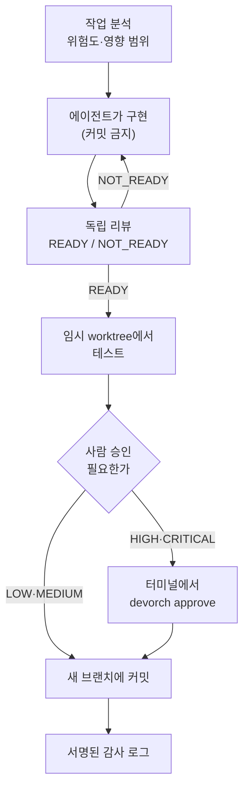

# DevOrch — AI 코딩 에이전트를 위한 통제 엔진

> AI 에이전트가 쓴 코드를 **바로 반영하지 않고**, 위험도를 분석하고 독립 리뷰·테스트·사람 승인을 통과한 변경만 새 브랜치에 커밋합니다.
> Claude Code 같은 에이전트에는 **MCP 서버**로 붙고, 사람은 CLI와 읽기 전용 대시보드로 확인합니다.



## 왜 만들었나

AI 코딩 에이전트는 빠르지만, 잘못된 변경도 똑같이 빠르게 들어옵니다. 리뷰가 빠지거나, 테스트가 깨진 채 반영되거나, 에이전트가 승인 단계를 건너뛸 수 있습니다.
DevOrch는 "AI가 코드를 잘 쓰게 만드는 도구"가 아니라 "**잘못 동작할 때 멈추게 만드는 도구**"입니다. 앞 단계를 통과하지 못하면 다음 단계 도구가 실행을 거부합니다.

## 핵심 설계

| 원칙 | 구현 |
|---|---|
| **단계를 건너뛸 수 없다** | 분석 → 리뷰 → 테스트 → 반영을 MCP 도구로 나누고, 리뷰가 없거나 `NOT_READY`면 테스트·반영 도구가 거부 |
| **검토한 것만 반영된다** | 리뷰·테스트·승인이 모두 **diff의 SHA**에 묶임. 이후 한 줄이라도 바뀌면 이전 결과는 무효 |
| **실패는 통과가 아니다 (fail-closed)** | 리뷰 호출·파싱 실패, 비용 상한 도달, 샌드박스 시작 실패는 모두 미완료로 처리 |
| **사람 승인은 에이전트가 대신 못 한다** | 승인 도구는 MCP에 없음. 사람이 터미널(TTY)에서 `devorch approve`. 승인·작업 기록은 프로젝트 밖의 키로 서명 |
| **리뷰어는 서로 독립** | 위험 등급에 따라 다른 모델·역할의 리뷰어를 병렬 배정, 서로의 결과를 보지 않음 |
| **비용을 먼저 보여준다** | 실행 전 예상 비용(범위)을 보여주고 확인을 받음. 끝나면 실제 비용과 비교, 작업당 비용 상한 |
| **변조를 알아챈다** | 감사 로그는 서명 사슬. 중간 수정·삭제·순서 변경·끝부분 잘림을 `devorch audit`이 탐지 |
| **비밀은 밖으로 안 나간다** | `.env`·키 파일은 diff 수집에서 제외, 자격증명 형태의 문자열이 있으면 리뷰 자체를 거부 |

## MCP 도구 (에이전트용)

| 단계 | 도구 | 하는 일 |
|---|---|---|
| 1 | `devorch_analyze_task` | task_id 발급, 위험도·영향 범위·필요한 리뷰/테스트/승인 안내 |
| 2 | (에이전트가 구현) | 작업 트리 수정, 커밋 금지 |
| 3 | `devorch_request_review` | 현재 diff를 독립 리뷰어가 검토 |
| 4 | `devorch_run_tests` | 임시 worktree에 diff를 적용해 테스트 (리뷰 통과 전에는 거부) |
| 5 | `devorch_apply_changes` | 리뷰·테스트(·사람 승인)를 통과한 diff를 **새 브랜치**에 커밋 |

보조 도구: `devorch_inspect_project`, `devorch_analyze_risk`, `devorch_analyze_impact`, `devorch_get_diff` · 리소스 3개(`devorch://policy`, `devorch://project`, `devorch://task/{id}`)

## 리뷰 품질을 숫자로 확인하기 — Benchmark

리뷰어가 정말 문제를 찾는지 확인하려고, **결함을 일부러 심어 둔 케이스 16개**(결함 13 + 깨끗한 대조군 4)로 탐지율과 오탐률을 잽니다.

- 통계 단위는 결함이고, 95% Wilson 신뢰구간과 쌍체 부호검정을 함께 보고합니다.
- 정규식 채점에 더해 **LLM 판정기**를 두 번째 의견으로 씁니다. 판정기는 어느 모델이 쓴 지적인지 모르게(블라인드) 하고, 판정 실패는 탐지도 미탐지도 아닌 "미판정"으로 따로 셉니다.
- 실측 예(2026-10-09, 16케이스 4개 모드 각 1회, 96호출, $0.347): 결함 단위 탐지 multi 12/13, single 10/13, Gemini 단독 12/13, OpenAI 단독 12/13.
  **쌍체 p = 0.5~1.0이라 모드 간 차이는 통계적으로 확인되지 않았습니다.** 확인된 것은 multi가 다른 구성보다 약 3배 비싸다는 점입니다.

## 검증한 것과 하지 않은 것

| 구성요소 | 상태 |
|---|---|
| MCP 서버 (stdio, 도구 8개 + 리소스 3개) | ✅ Windows에서 실제 stdio 하위 프로세스로 분석→리뷰→테스트→커밋, 승인 필요 작업의 거부까지 테스트. **실제 Claude Code**(헤드리스 + IDE)에서 승인→커밋→merge까지 확인 |
| 실제 LLM 어댑터 (Anthropic / OpenAI / Gemini) | ✅ 세 회사 모델 모두 실제 호출 성공 |
| Docker 샌드박스 (테스트 단계) | ✅ 실제 Docker(Windows/WSL2)에서 비root·네트워크 차단·서명 키 접근 불가·자원 제한 확인. 샌드박스 없이 재현된 "악의적 테스트의 승인 위조"가 샌드박스에서는 막힘 |
| 영향 분석 (py/js/ts/java/kt import 그래프) | ✅ 정규식 휴리스틱 |
| 대시보드 (읽기 전용) | ✅ API 테스트, 실제 Chromium에서 렌더링·XSS 확인 |
| Cursor 등 Claude Code 외 클라이언트, macOS·rootless Docker | ⚠️ 미검증 |
| 위험도 분류 | ⚠️ 작업 문장과 파일 경로의 키워드 기반 추측. 실제로 놓친 사례가 있어 소유자가 지정하는 `protected_paths`를 추가함 |

**한계도 숨기지 않습니다.** 같은 OS 사용자로 실행되는 코드는 서명 키를 읽을 수 있으므로, 신뢰할 수 없는 에이전트와 쓸 때는 Docker 샌드박스를 켜야 합니다. 자세한 신뢰 모델은 [상세 레퍼런스](docs/REFERENCE.md#통제-장치가-지켜-주는-것과-지켜-주지-못하는-것-신뢰-모델)에 있습니다.

## 직접 재현하고 고친 문제

다른 개인 프로젝트에 붙여 쓰거나 공격 시나리오를 직접 재현하면서 찾은 문제를 고쳤습니다. 실사용 기록은 [`docs/DOGFOOD_LOG.md`](docs/DOGFOOD_LOG.md)에 있습니다.

- 실제 저장소에서 발행 큐의 상태를 바꾸는 파일 수정이 문장·경로에 위험 신호가 없어 LOW로 커밋됨 → 소유자가 지정하는 **보호 경로**(`protected_paths`)로 위험도를 끌어올리게 함
- 파일을 쓸 수 있는 에이전트가 리뷰 없이 정책 파일을 고칠 수 있었음(재현) → 사람이 승인한 정책의 해시를 프로젝트 밖에 서명해 두고, 달라지면 도구가 멈추게 함
- 비용 상한에 `NaN`을 넣으면 상한이 영원히 작동하지 않음 (AI 리뷰어가 지적, 재현 후 수정) → 유한한 값만 받도록 수정

## 빠른 시작

Python 3.11 이상과 git이 필요합니다.

```bash
python -m venv .venv && . .venv/bin/activate      # Windows: .\.venv\Scripts\Activate.ps1
pip install -e ".[dev,llm]"

devorch quickstart                                 # 처음이라면 이 하나로: git 확인 → 초기화 → 점검 → 정책 승인 → MCP 등록 명령까지 (--mock: 연결 시험용)
devorch doctor                                     # 이 컴퓨터에서 막히는 곳 점검 (LLM 호출 없음)
devorch init                                       # .devorch/config.yaml, policy.yaml 생성
devorch policy accept                              # 사람이 정책을 확인하고 승인
devorch analyze "로그인 기능에 JWT 인증 추가해줘"     # LLM 호출 없이 위험도·영향·예상 비용
devorch run "로그인 JWT 인증 추가" --mock            # 가짜 리뷰어로 전체 흐름 시연
pytest
```

Claude Code에 연결:

```bash
claude mcp add devorch -- devorch mcp -p /path/to/project
```

API 키는 환경변수로만 넣습니다. 설정, `--apply`, 비용 계산 방식, Docker 샌드박스, 대시보드 등 전체 사용법은 [상세 레퍼런스](docs/REFERENCE.md)를 보세요.

## 구성

```
src/devorch/
├── core/          # analyzer(위험도·영향), router, evaluator, orchestrator(상태 머신), policy, execution
├── providers/     # Anthropic / OpenAI / Gemini 어댑터, Mock
├── security/      # 시크릿 마스킹, 명령 allowlist, 경로 탈출 방지
├── bench/         # 시드 결함 케이스, 채점, LLM 판정기, 리포트
├── dashboard/     # 읽기 전용 로컬 웹 UI
├── mcp_server.py  service.py  store.py  audit.py
└── cli/
tests/             # 테스트 함수 473개 (Docker·stdio 통합 테스트 포함), GitHub Actions CI
```

**규모:** Python 약 7,500줄 · 테스트 함수 473개 · 커밋 72개 (2026-10-08 ~ 진행 중) · 1인 개발

## 문서

- [사례 연구](docs/CASE_STUDY.md) — 규모, 실사용 결과, 재현·수정 기록, 탐지율 측정, 한계
- [상세 레퍼런스](docs/REFERENCE.md) — 전체 사용법, 신뢰 모델, 비용 추정, 샌드박스, 벤치마크 세부
- [평가 설계](docs/EVAL_DESIGN.md) · [실사용 기록](docs/DOGFOOD_LOG.md) · [IDE 확인 절차](docs/IDE_CHECK.md) · [인수인계](HANDOFF.md)
